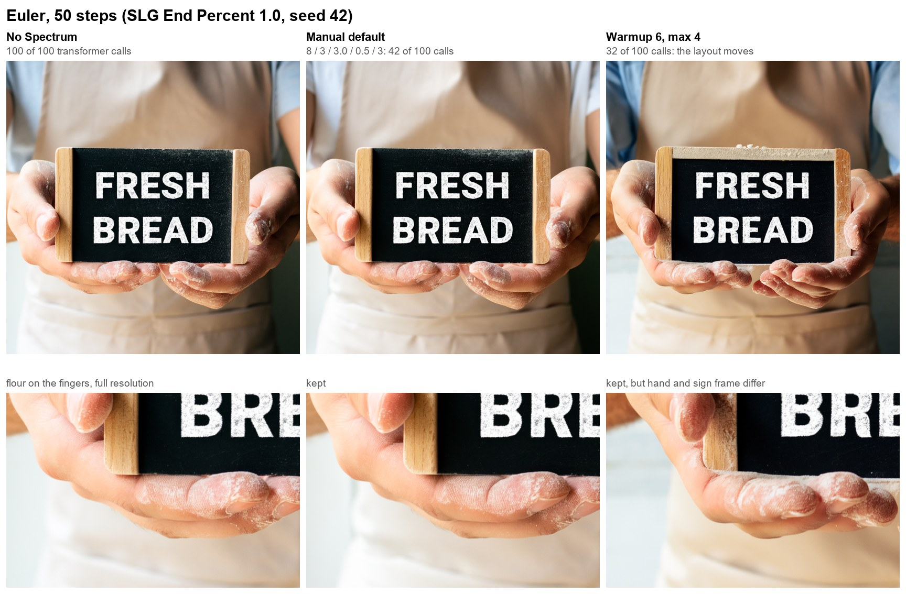
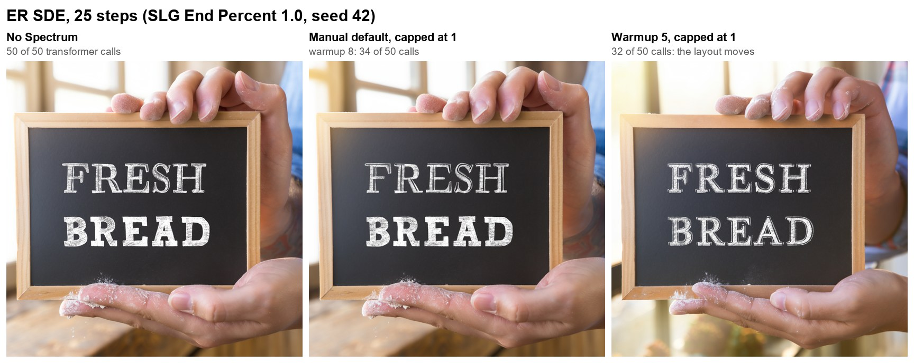
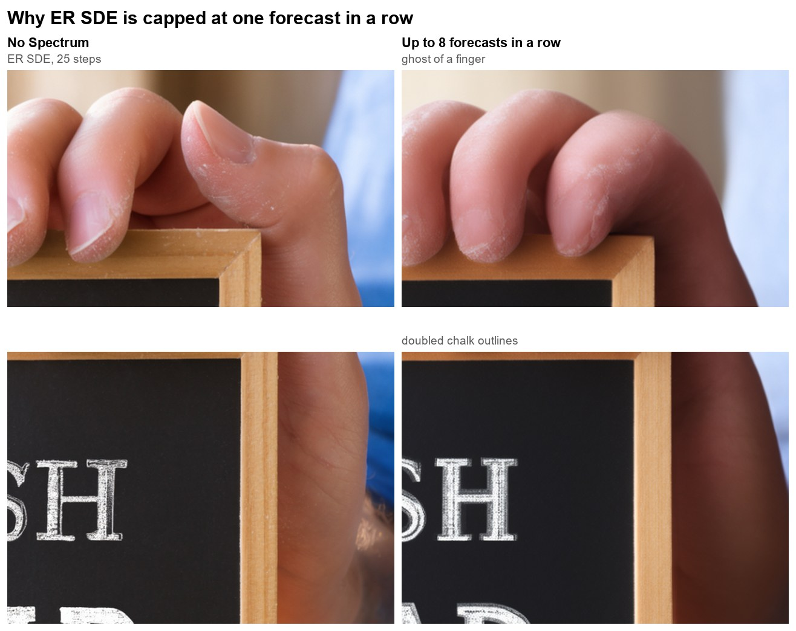
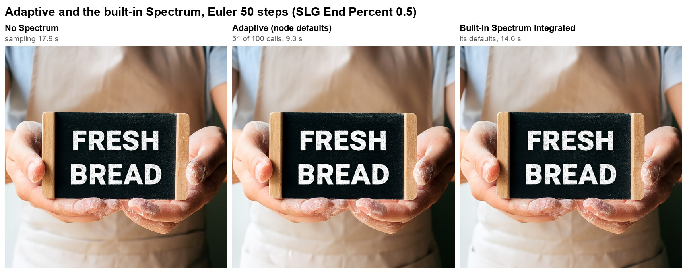

# Neo Spectrum DiT

A **Forge Neo** extension that skips transformer evaluations on **MOSS-Image** and **FIBO 2** by forecasting them. It is a port of [Rkkss/ComfyUI-Spectrum-MOSS](https://github.com/Rkkss/ComfyUI-Spectrum-MOSS) v0.8.0 (MOSS-Image), extended to FIBO 2.

On a forecast step the transformer does not run. The extension predicts the image tokens' hidden state as it enters the model's output head, from the real steps before it (a ridge-regularised Chebyshev fit blended with linear extrapolation), and runs only that small, timestep-conditioned head on the prediction. On MOSS-Image this runs about 2x fewer transformer calls in Adaptive mode, with an image close to the unaccelerated one.

## Supported models

| Model | Needs | Status |
| --- | --- | --- |
| MOSS-Image | Forge Neo with native MOSS-Image support (be6fa5d4, 2026-10-21, or later) | Tested live; the examples below |
| FIBO 2 | the [fibo2-forge-neo](https://github.com/eduardoabreu81/fibo2-forge-neo) extension | Checked on CPU against the real model code; not yet tested live |

On any other model the extension stands down and says so in the console.

## How it differs from the built-in Spectrum

Forge Neo ships **Spectrum Integrated**, which forecasts the model's whole output and works on any model. This extension forecasts one level earlier, before the output head, so the head still sees the true timestep. It also brings the original's two schedulers and its ER SDE bridge. Use one or the other: with Spectrum Integrated enabled, this extension stands down and says so in the console.

## Install

Extensions → Install from URL:

```text
https://github.com/aoleg/Neo-Spectrum-DiT
```

Or clone into your Forge Neo `extensions` folder and restart. No extra dependencies.

## Usage

Open the **Spectrum DiT** accordion, tick it, and generate. The console reports how many transformer calls ran, for example `Spectrum DiT: MOSS-Image, 50 steps, 51 of 100 transformer calls run (1.96x fewer)` (cond and uncond count separately).

Other samplers than Euler and ER SDE run, but only those two were validated; the console warns once per pass (Advanced → Warn on unverified samplers turns that off). ER SDE is detected and goes through the solver bridge automatically.

### MOSS-Image

Recommended settings, from the original node:

- OpenMOSS: 50 steps, Euler, Simple (Forge Neo's MOSS-Image preset).
- Comfy-Org template: 25 steps, ER SDE, Simple.

**Set Skip Layer Guidance's End Percent to 1.0.** Forge Neo enables MOSS-Image Skip Layer Guidance by default, from 0 to 0.5. It is in **Settings → Stable Diffusion**, under "[Moss-Image] Enable Skip Layer Guidance" (type `Skip Layer` into the settings search). When SLG stops halfway, the negative prompt's model call changes, so its forecast history starts over while the positive side keeps forecasting. The two drift out of step, and a run can go many steps without one fully real step. That costs speed and, under ER SDE, image quality. The original's README recommends the same for ComfyUI.

While the older `moss-image-forge-neo` extension is installed, its model loader wins and Spectrum stands down for MOSS-Image, because it rebuilds the output head from Forge Neo's own MOSS-Image code.

### FIBO 2

- **FIBO 2 Dev, 50 steps, CFG 5, Euler, Simple** (the fibo2 preset) is where Spectrum pays off: each real step of FIBO 2 is expensive.
- **Turbo (Edit Turbo, or Dev with the turbo LoRA), 4 steps:** no gain. Warmup alone covers every step, so Spectrum runs them all for real. It does no harm.
- **Use Adaptive.** Manual's defaults were tuned on MOSS-Image.
- **Text pictures.** When a caption has `text_render` entries, FIBO 2 switches to a second text conditioning at sigma 0.9 (about step 13 of 50 at 1024x1024). The hidden state jumps there, so Spectrum starts a fresh forecast history at the switch and runs a few real steps to rebuild it.
- **Edits** work as usual: the reference images do not reach the output head, so they do not change what is forecast.

## Examples

MOSS-Image Base (int8), 1024x1024, CFG 4.5, seed 42, one prompt with text and floury hands. "Calls" counts cond and uncond separately.

With the Manual defaults, Euler runs 42 of 100 transformer calls and the image stays close to the unaccelerated one, down to the flour on the fingers. A shorter warmup is faster but moves the layout.



Under ER SDE the default runs 34 of 50 calls. Warmup decides the layout here too.



What a longer forecast streak does to ER SDE, and why Manual is capped at one forecast in a row there:



Adaptive mode and Forge Neo's built-in Spectrum Integrated, from an earlier run with SLG ending at 0.5. Times are the sampling loop on one test machine.



## Modes

### Adaptive (default)

The original's **Spectrum MOSS-Image (Adaptive)** node, with its defaults. It is the default because it measures its own forecast error at every real step and backs off when the error grows, so it does not depend on the model, the sampler, the schedule or a Turbo LoRA matching what the defaults were tuned on. The error is measured on a sample of image tokens (95th and 99th percentile, so a small drifting region such as a hand is not averaged away), and the forecast streak shortens or lengthens with it.

| Control | Default | Description |
| --- | --- | --- |
| Adaptive warmup steps | 8 | First steps that always run the transformer. |
| Adaptive tail steps | 2 | Last steps that always run the transformer. |
| Detail guard steps | 8 | After warmup, at most one forecast between real steps. |
| Post-guard horizon cap | 6 | Longest forecast streak after the guard. ER SDE: 1. |
| Error tolerance | 1.0 | Forecast error tolerated before backing off. Higher = faster, riskier. |
| Forecast budget | 2.0 | Starting forecast budget before the next real step (the node's `window_size`). ER SDE: ignored. |
| Budget growth | 0.5 | How fast the budget grows after good refreshes (the node's `flex_window`). ER SDE: ignored. |

### Manual

The original's **Spectrum MOSS-Image (Manual)** node: a fixed expanding-window schedule. It is faster than Adaptive, but a fixed schedule suits only the setups it was tuned on: MOSS-Image with Euler and ER SDE, without a few-step LoRA. The defaults come from live tests there (Euler, 50 steps, SLG End Percent 1.0): about 2.4x fewer transformer calls with an image close to the unaccelerated one. The node's own values are in brackets.

| Control | Default | Description |
| --- | --- | --- |
| Warmup steps | 8 | First steps that always run the transformer. MOSS-Image is still placing the composition until about step 8; a lower warmup changes the layout. |
| Tail actual steps | 3 (2) | Last steps that always run the transformer. A longer tail (8) made no visible difference. |
| Window size | 3.0 (2.0) | Starting forecast window before a real step. |
| Window growth | 0.5 (0.75) | How much the window grows after each refresh. |
| Max consecutive forecasts | 3 (2) | Forecasts allowed in a row before a real step. **ER SDE: always 1**, see below. |
| History points | 8 | Real hidden states kept for the predictor. ER SDE: fixed at 8. |
| Chebyshev degree | 4 | Polynomial degree of the predictor. ER SDE: fixed at 4. |
| Ridge lambda | 0.1 | Regularisation; higher damps extrapolation. ER SDE: fixed at 0.1. |
| Blend weight | 0.5 | 0 = linear extrapolation only, 1 = spectral only. ER SDE: fixed at 0.5. |
| Real steps while a ControlNet is active | on | |

**ER SDE caps Manual at one forecast in a row,** whatever the slider says, which is where this port departs from the original node. The ER SDE bridge can only extrapolate from two consecutive real steps. After a longer streak it has to reuse the last real result while ER SDE keeps adding noise, and the image ghosts: doubled outlines and translucent duplicate fingers in a live test with 8 in a row. Adaptive already caps itself the same way. With the default warmup of 8, ER SDE at 25 steps runs about 1.5x fewer transformer calls.

### Advanced

| Control | Default | Description |
| --- | --- | --- |
| Cache device | main_device | Where the hidden-state history lives. `main_device` is fastest but uses VRAM (about 25 MB per kept state for MOSS-Image at 1024x1024, about 29 MB for FIBO 2, per batch item); `cpu` or `offload_device` save VRAM at some speed. |
| Apply to the Hires. fix pass | on | |
| Warn on unverified samplers | on | Changes nothing but the console. |
| Debug log | off | Every decision, the forecast error and the final counts. |

All settings are written to the infotext and restored by "Read generation parameters", for pictures made with earlier versions too.

## Implementation notes

The scheduler, the forecaster and the adaptive controller (`lib_spectrum_dit/core.py`) are the original node's code, unchanged apart from two flags that Forge supplies differently and the ER SDE cap on Manual described above. What is new:

- **Model adapters** (`lib_spectrum_dit/models.py`). Per model: how to recognise it, where to capture the image tokens' hidden state (MOSS-Image: the last block's output; FIBO 2: the final layer's input, past the text "gist" tokens), how to run its output head on a forecast, and what starts a new forecast history (FIBO 2's text phase). FIBO 2 is recognised by its class name, so the extension does not depend on the fibo2-forge-neo extension being installed or loaded first.
- **Hook.** The node wraps the diffusion model; Forge Neo's nearest hook is the `model_function_wrapper` around `KModel.apply_model`. A forecast step reproduces what `apply_model` does around the transformer: `calculate_input`, the head at `predictor.timestep(sigma)`, `calculate_denoised`. Another extension's wrapper already in that slot is chained, not replaced, and sees only the real steps.
- **Step index.** It comes from `transformer_options["sampling_sigmas"]`, rebased to the first sigma of the run: for img2img and the hires pass Forge publishes the full schedule while the sampler runs only its tail, so without the rebase warmup and the detail guard would be skipped.
- **ER SDE.** The node copies ComfyUI's sampler only to capture ER SDE's lambda coordinates. Forge Neo's `sample_er_sde` computes them from the sigmas, so the bridge computes the same values up front and never touches the sampler; the guided result reaches it through a post-CFG function.
- **Release with partial SLG.** The node frees its stored hidden states only after every call pattern reaches the last step, which never happens when SLG ends at the midpoint. The port frees them once every pattern still running near the end has finished.

## Credits

- Spectrum-MOSS node: Rkkss, https://github.com/Rkkss/ComfyUI-Spectrum-MOSS
- Spectrum method: *Adaptive Spectral Feature Forecasting for Diffusion Sampling Acceleration*, arXiv:2603.01623; official implementation https://github.com/hanjq17/Spectrum
- ER SDE solver-space bridge approach: https://github.com/xmarre/ComfyUI-Spectrum-MiniMax-H3
- FIBO 2 in Forge Neo: eduardoabreu81, https://github.com/eduardoabreu81/fibo2-forge-neo

## License

GPL-3.0-only, as the original. See `LICENSE`.
